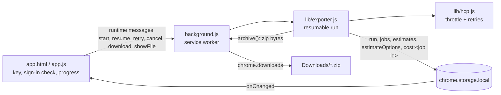

# Handoff: SHVR Data Export → SHVR integration

> Update 2026-11-25: Jobber exports now include line items for jobs, quotes and invoices (`*_line_items.csv` plus `line_items_status.csv`; see README.md and "Jobber line items" below), and the wrong-company check needs the first three jobs refused, not one. Neither change has had a live run. The live test account's name and organization id were removed from this file.
>
> Update 2026-11-16: the extension is now **SHVR Data Export**, with ServiceTitan support (searches plus optional job attachments, no API key) and Jobber support (GraphQL with the browser's session; jobs, clients, quotes, invoices, requests and their files) beside Housecall Pro, and the SHVR visual theme. README.md's "Chrome extension" section documents the ServiceTitan and Jobber endpoints, how attachments are listed and downloaded, and the two-zip layout (data, then attachments). The Housecall Pro details below are unchanged; zip files are now named `SHVR Export - <company> - <date>.zip`.

Read this before building the SHVR side. It covers what exists in this repo, what has been proven against a live Housecall Pro account, the data contract, and the seams an integration should use.

## What exists

| Piece | Path | State |
| --- | --- | --- |
| Franchisee cookie minting (original tool) | `hcp_session.py` | Unchanged. Only needed for franchisor-level access; the export doesn't use it. |
| CLI export | `hcp_export.py` | Done. Writes `jobs.csv`, `materials.csv`, `miscellaneous_items.csv`, `estimates.csv` and `estimate_options.csv`, plus raw JSON, to `exports/`. |
| Chrome extension | `extension/` | Done and tested end to end. Not yet on the Chrome Web Store. |
| Web Store submission kit | `store/LISTING.md`, `store/PRIVACY.md`, `store/screenshot-running.png` | Ready apart from the open items below. |
| Tests | `tests/extension/*.test.mjs`, `test_hcp_export.py`, `test_hcp_session.py` | `npm test` runs all of them: 42 node tests and 24 Python tests, all passing. |

The audience is non-technical Housecall Pro operators. They can paste an API key, but they can't copy a browser cookie. That constraint is why the extension exists: it uses the browser's own Housecall Pro sign-in, so nobody handles the cookie.

## Verified against a live account (one Housecall Pro company, 2026-11-12)

- **CLI:** 609 jobs, 1,339 materials and 436 miscellaneous items. There were no failures and no 429s at 0.5s spacing.
- **Extension:** loaded unpacked in Chrome for Testing. The zip held exactly the same row counts as the CLI.
- **First-run states:** a bad key shows an error, a real key shows the company name, no HCP session shows the "Sign in" prompt, and signing in enables Export.
- **Download name:** the zip was named after the company and the date (the name is now `SHVR Export - <company> - <date>.zip`).
- **Worker restart:** I killed the service worker mid-export. The open page restarted it within 5s, and it continued from the next unfinished job.
- **Request spacing:** lowered from 0.5s to 0.1s at the user's request, in both `extension/lib/hcp.js` (`DEFAULT_DELAY_MS`) and `hcp_export.py` (`DEFAULT_DELAY`). At 0.1s, the public API listing (7 pages of jobs, 19 of estimates) has run live with no 429s. The private per-job cost calls haven't had a full run at 0.1s yet; that run reused saved costs. The user is testing that themselves.
- **Estimates (added after the handoff was first written):** a live CLI run at 0.1s spacing listed 1,860 estimates and 2,830 estimate options with no 429s. All 487 jobs with an `original_estimate_id` matched an `option_id` in `estimate_options.csv`. The extension writes the same two files into its zip; that path is covered by unit tests but hasn't had a live browser run yet.

## How it talks to Housecall Pro

| Data | Request | Auth |
| --- | --- | --- |
| Company name and id | `GET https://api.housecallpro.com/company` | `Authorization: Token <API key>` |
| Jobs | `GET https://api.housecallpro.com/jobs?page=N&page_size=100` (stop at `total_pages`) | API key |
| Sign-in check | `GET https://pro.housecallpro.com/alpha/organization/job_line_item_details_settings` | Browser session cookie |
| Materials | `GET https://pro.housecallpro.com/alpha/job_costing/job_input_materials?job_uuid=<job id>&expand[]=material_vendor&expand[]=material_purchase_status&expand[]=material_source` | Browser session cookie |
| Miscellaneous items | `GET https://pro.housecallpro.com/alpha/jobs/<job id>/miscellaneous_items` | Browser session cookie |

- **Session cookie:** `_housecall-web_session_with_domain` on `.housecallpro.com`. The extension never reads it. It calls `fetch(..., {credentials: "include", redirect: "manual"})` from extension pages and the service worker, and host permissions make Chrome attach it.
- **Signed out:** the browser's fetch gets an `opaqueredirect` or a 401. A 200 with a non-JSON body also counts as signed out.
- **API key access:** keys require HCP's MAX plan, and only an admin can create one (My Apps › All Apps › API Key Management). A read-only key is enough.
- **Retries:** a 429 waits for `Retry-After` (default 5s, up to 6 retries). A 5xx or network error backs off 2, 4, 8 and 16s. A 401 stops the run.
- **Wrong company:** the browser can be signed in to a different HCP company than the API key's, which matters for franchise multi-location users. The extension infers that when the first three jobs' costs (`WRONG_COMPANY_PROBE` in `extension/lib/exporter.js`; all of them when there are fewer) each come back 403 or 404 before any job has succeeded, and then shows a "switch company" error. A single refused job at the start is recorded as a failed job instead. This heuristic hasn't been checked live.
- **Private API contract:** the shapes are documented in `~/Code/_kickback/costr/docs/HCP_API.md`, the Kickback costr repo. That repo's `app/clients/hcp_private_api_client.rb` covers the same endpoints, plus the write calls.

## Data contract (the export CSVs)

All money is in dollars with two decimals; HCP sends cents. Every cost row carries `job_id` (the HCP job id, `job_…`) and `invoice_number`, so it joins back to `jobs.csv`. The extension's CSVs start with a UTF-8 byte-order mark and use CRLF line endings (for Excel); the CLI's have neither.

- **`jobs.csv`:** `job_id, invoice_number, description, work_status, customer_id, customer_name, customer_company, customer_email, customer_mobile, street, street_line_2, city, state, zip, scheduled_start, scheduled_end, on_my_way_at, started_at, completed_at, created_at, updated_at, canceled_at, deleted_at, subtotal, total_amount, outstanding_balance, assigned_employees, assigned_employee_ids, tags, lead_source, job_type, business_unit, original_estimate_id, recurrence_rule`
  - Multi-valued fields are joined with `; `.
- **`materials.csv`:** `job_id, invoice_number, material_uuid, name, part_number, description, quantity, unit_of_measure, unit_cost, total_cost, vendor, vendor_uuid, purchase_status, purchase_status_uuid, material_source, material_source_uuid, pricebook_material_uuid`
  - `total_cost` is quantity × unit cost, rounded to the cent.
  - On this account the vendor, purchase-status and source fields are empty.
  - Material names often look like `SW New — Invoice #58025`, with the description `PO: <invoice number>`. These rows were written by Kickback's cost matching.
- **`miscellaneous_items.csv`:** `job_id, invoice_number, item_uuid, name, description, quantity, unit_cost, total_cost`
  - `quantity` comes from `qty_in_hundredths / 100` when that field is present.
  - This account uses these rows for subcontractor labor (for example `Labor - Luis G`).

- **`estimates.csv`:** `estimate_id, estimate_number, work_status, customer_id, customer_name, customer_company, customer_email, customer_mobile, street, street_line_2, city, state, zip, scheduled_start, scheduled_end, on_my_way_at, started_at, completed_at, created_at, updated_at, assigned_employees, assigned_employee_ids, lead_source, job_type, business_unit, option_count`
  - `estimate_id` is the estimate itself (`csr_…`).
- **`estimate_options.csv`:** `estimate_id, estimate_number, option_id, option_number, name, total_amount, approval_status, approval_status_updated_at, status, tags, created_at, updated_at`
  - `option_id` (`est_…`) is what a job's `original_estimate_id` points at, so jobs join to estimates through this file.
  - Both files come straight from `GET /estimates` (options are embedded in each estimate), so they add only one request per 100 estimates and no private API calls.

`extension/lib/rows.js` and the row functions in `hcp_export.py` define the columns; keep the two in step.

### Jobber line items

The Jobber data zip adds, beside `jobs.csv`, `quotes.csv` and `invoices.csv`:

- **`job_line_items.csv`, `quote_line_items.csv`, `invoice_line_items.csv`:** `<record>_id, <record>_number, position, line_item_id`, then every plain field Jobber's schema lists for that line item type, under Jobber's own field names. `<record>_id` joins to `id` in the record's CSV. `position` is the item's order on the record, from 1. Amounts are passed through as Jobber sends them.
- **`line_items_status.csv`:** `record_type, status, records, line_items, error`. `status` is `complete`, `partial` (some pages were read, then Jobber refused) or `unavailable`. An importer should treat a line item file as authoritative only when its status is `complete`; an empty file with `complete` means no record had line items.

The Housecall Pro export still has no price-side line items (only costing materials and miscellaneous items), and ServiceTitan's come only as whatever its searches return.

## Extension architecture



- **Storage keys:**
  - `apiKey` and `company`.
  - `run`: status `listing | costs | done | error | canceled`, with counters, `failed[]`, `error.kind` (`api_key | session | wrong_company | other`) and `pace` for the time estimate.
  - `jobs`: job rows.
  - `cost:<job id>`: `{materials, misc}` rows.
- **Service worker lifetime:** Chrome stops an idle worker after 30s. Long waits in `background.js` call an extension API every 10s to stay alive. If the worker dies anyway, the open page sends `resume` every 5s.
- **No build step:** the extension is plain ES modules. `npm run package` zips `extension/` into `dist/` for upload.

## Seams for the SHVR side

I don't know what SHVR's system looks like. Settle that before choosing a seam:

1. **Hand over the zip:** SHVR ingests the five CSVs the extension already produces. Nothing in this repo changes. The data contract above is the interface.
2. **Push from the extension:** add a step after `exporter.archive()`, or read the rows from storage, and POST them to an SHVR endpoint. The natural hook is `onFinished` in `background.js` (it currently calls `saveArchive`). This needs:
   - an SHVR host permission in `manifest.json`;
   - a way to pair the user's install with their SHVR account (for example a pairing token the user pastes, alongside the API key);
   - an update to `store/PRIVACY.md` and the Web Store data disclosures, which currently promise that nothing leaves the browser except to Housecall Pro.
3. **Server-side pull:** SHVR calls HCP itself. The jobs need only the API key. The materials and miscellaneous items need a live browser session cookie, and SHVR's users can't supply one by hand. Kickback solved the same problem with a companion extension that reads the cookie through `chrome.cookies` and posts it to the platform (`~/Code/_kickback/costr/extension/`). Session cookies expire, so this needs a refresh story.

Questions to answer first:
- Which of these shapes does SHVR want?
- Where does SHVR run, and does it have an API for receiving the data?
- How do SHVR users map to HCP companies (one company each, or several locations)?
- Should the export be incremental (only jobs changed since the last export) instead of a full pull every time? Today every run is a full pull.

## Open items

- [ ] Submit to the Chrome Web Store as unlisted. This needs a Chrome Web Store developer account. Upload the zip from `npm run package`, and paste the text from `store/LISTING.md`.
- [ ] Put a real contact email in `store/PRIVACY.md` (it has a placeholder), host it publicly (a Gist or GitHub Pages), and paste its URL into the listing.
- [ ] Optional: add a second store screenshot of the "done" state.
- [ ] Confirm a full live run at 0.1s spacing stays clear of 429s.
- [ ] Check the wrong-company heuristic with a franchise user signed in to the wrong location.
- [ ] Run a Jobber export against a real account and confirm the three line item files are `complete` and the listing still fits the cost budget.

## Run and test

```bash
npm test                      # node extension tests + python tests
npm run package               # dist/shvr-data-export-<version>.zip
python3 hcp_export.py --api-key-file ~/.config/hcp-private-api/api.key \
  --session-cookie-file ~/.config/hcp-private-api/session.cookie   # CLI export
```

To try the extension locally, open `chrome://extensions`, turn on Developer mode, click **Load unpacked**, and choose `extension/`.

For a headless end-to-end run, use Chrome for Testing; Chrome stable ignores `--load-extension`. Launch it with `--load-extension=<repo>/extension --disable-extensions-except=<repo>/extension`, set the HCP cookie with CDP `Storage.setCookies` (domain `.housecallpro.com`), then open `chrome-extension://<id>/app.html`. Overriding downloads with `Browser.setDownloadBehavior` makes Chrome ignore the extension's file name and save `download.zip`; leave the download behavior at its default to check naming.

Secrets stay out of git: `*.key`, `*.cookie`, `exports/`, `dist/` and `.env` are ignored.
